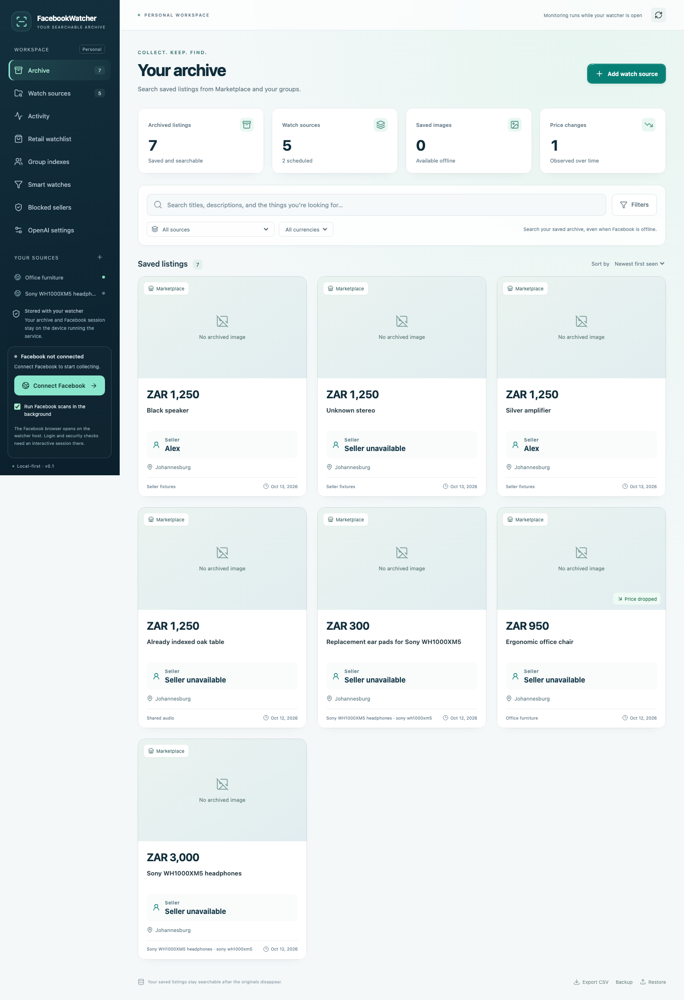

# Facebook Watcher

**Find it on Facebook. Keep it in your archive.**

Turn Facebook Marketplace searches and groups into a searchable archive of listings, prices, photos and observed changes. Find saved listings later, even when Facebook is offline.

[**Download Facebook Watcher**](https://github.com/VelocityCubed/FacebookWatcher-Releases/releases/latest) · [Installation](docs/installation.md) · [User guide](docs/user-guide.md) · [Troubleshooting](docs/troubleshooting.md) · [Agent setup and MCP](docs/mcp.md)



_App preview using synthetic sample listings. Your archive starts empty._

## Download

Open the [latest release](https://github.com/VelocityCubed/FacebookWatcher-Releases/releases/latest), expand **Assets**, and choose your installer:

| Your computer                                | Download                                   |
| -------------------------------------------- | ------------------------------------------ |
| Mac with Apple silicon (M1, M2, M3 or newer) | `FacebookWatcher-VERSION-darwin-arm64.dmg` |
| Mac with an Intel processor                  | `FacebookWatcher-VERSION-darwin-x64.dmg`   |
| Windows x64                                  | `FacebookWatcher-VERSION-win32-x64.exe`    |

On a Mac, **Apple menu → About This Mac** identifies your chip or processor. You do not need Node.js, Git, a separate browser installation or a GitHub account to download the app. Linux and Windows ARM installers are not provided.

Install the version shown on the latest release page; do not hardcode a release version in automation. If you use v0.1.1, install a current version manually once to move to the public update feed. Mac signing and approval requirements are listed in the release notes.

## Installation checklist for people and agents

1. Identify the operating system and CPU architecture. On macOS use `uname -m`: `arm64` selects `darwin-arm64.dmg`, `x86_64` selects `darwin-x64.dmg`. On Windows, check **Settings → System → About → System type**; use the installer only on x64 Windows. Stop if no compatible installer exists.
2. Resolve the [latest stable release](https://github.com/VelocityCubed/FacebookWatcher-Releases/releases/latest) and select the exact DMG/EXE asset for that platform. Do not choose **Source code**, updater ZIPs, `.nupkg` or `RELEASES` for first installation.
3. Download that asset. With GitHub CLI already installed, these examples download exactly one installer into a new empty folder (no repository clone or GitHub login is required for public browser downloads):

   ```sh
   # Apple silicon Mac; use *-darwin-x64.dmg for Intel
   gh release download --repo VelocityCubed/FacebookWatcher-Releases --pattern '*-darwin-arm64.dmg' --dir ./facebook-watcher-download
   ```

   ```powershell
   # Windows x64, with GitHub CLI available
   gh release download --repo VelocityCubed/FacebookWatcher-Releases --pattern '*-win32-x64.exe' --dir ./facebook-watcher-download
   ```

4. On macOS open the DMG, copy **FacebookWatcher.app** into **Applications**, eject the DMG and launch the installed app. On Windows run the downloaded Setup EXE and launch from Start. For an upgrade, back up the archive and quit the old app first. Follow [platform installation instructions](docs/installation.md) for OS approval prompts; the user must complete any required system authorization.
5. Verify that the main window opens and **App updates** reports the expected installed version. Choose **Connect Facebook** and let the user sign in in the dedicated browser; passwords and security codes stay there.
6. Add one source with scheduled scans paused, run **Scan now**, and check **Activity** for its final outcome. A successful installation does not establish successful Facebook collection. Review saved results before enabling schedules.

**Agent handoff:** report installed version, platform, app location, launch result, Facebook connection state and first scan outcome. Say explicitly if login or system approval is still pending. Leave recurring collection paused unless requested.

### Connect an agent through MCP

The local MCP bridge controls the same running watcher: search saved listings, inspect history/images, manage sources/jobs, operate the retail watchlist and use installed source providers. See the [complete MCP guide](docs/mcp.md) for all **33 tools**, inputs, examples, private discovery and troubleshooting.

MCP currently requires **Node.js 24.14+ and an authorized application-source checkout** to build `dist/mcp.cjs`. The public downloads do not include a standalone bridge; this documentation repository cannot be built with `npm ci`. Desktop users need no Node.js. Agents must not assume the installed app automatically registers MCP or invent a public npm package.

In the authorized source checkout, run `npm ci` and `npm run build`; keep the desktop running, then configure the host's stdio MCP entry:

```json
{
  "mcpServers": {
    "facebook-watcher": {
      "command": "node",
      "args": ["/absolute/path/to/FacebookWatcher/dist/mcp.cjs"]
    }
  }
}
```

Replace the path (Windows may use `C:/dev/FacebookWatcher/dist/mcp.cjs`). Discover tools and call `get_health`, `get_stats` and `get_session` to verify the connection. The bridge reads the desktop's private connection file; no manual token copying is needed. Interactive Facebook login remains with the user.

## What you can do

- **Watch Marketplace searches and groups.** Collect listings your Facebook account can access on a schedule you control.
- **Search your archive.** Filter by words, source, price, location and date, and revisit saved descriptions and images.
- **Track observed changes.** Keep the prices and details seen during successful scans.
- **Build Smart watches.** Filter shared group indexes or review AI-generated search plans before saving them.
- **Compare retail products.** Keep reference prices and review possible second-hand matches.
- **Keep useful results.** Dismiss irrelevant listings, block recognized sellers, export CSV files and back up your archive.

## Get started in five steps

1. [Install the app](docs/installation.md) for your computer.
2. Choose **Connect Facebook** and sign in directly in the dedicated Facebook browser.
3. Add a Marketplace search or Facebook group in **Watch sources**.
4. Run **Scan now**, then check **Activity** for the result.
5. Browse **Archive** and use search and filters to find saved listings.

Leave the app running for scheduled collection. Closing its window keeps it in the tray; choosing **Quit** stops its local watcher. A sleeping or powered-off computer cannot collect listings.

## Help and guides

- [Install, upgrade and uninstall](docs/installation.md)
- [User guide: sources, groups, searches, retail products and backups](docs/user-guide.md)
- [Troubleshooting and recovery](docs/troubleshooting.md)
- [Agent setup and complete MCP tool reference](docs/mcp.md)
- [Data and privacy](docs/privacy.md)
- [Release history and downloads](https://github.com/VelocityCubed/FacebookWatcher-Releases/releases)
- [Report a problem](https://github.com/VelocityCubed/FacebookWatcher-Releases/issues)

Include your app version, operating system, steps to reproduce and the message shown in **Activity** when reporting a problem. Public issues are visible to everyone: remove passwords, tokens, private group links, personal listing information and other sensitive details.

## About this repository

This is the public home for Facebook Watcher downloads, user documentation and release notes. Application source code and build automation are maintained separately. GitHub's automatically generated **Source code** archives contain only this repository's documentation; use the DMG or EXE installer to install the app.

Facebook Watcher is an independent application and is not affiliated with or endorsed by Meta or Facebook. Scans are bounded snapshots of what your account can see, not a guarantee of complete coverage or item availability. Use the app in line with the permissions and terms that apply to your account and the content you access.
